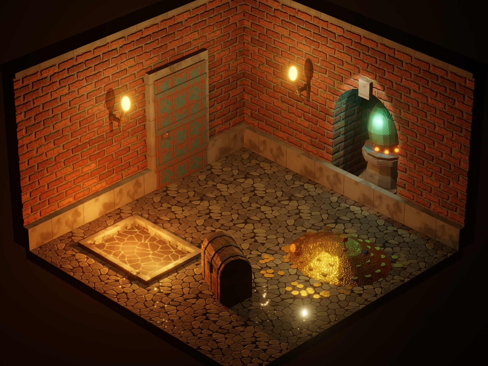
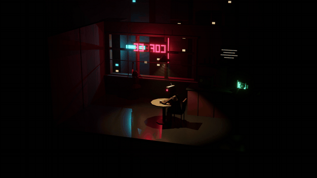
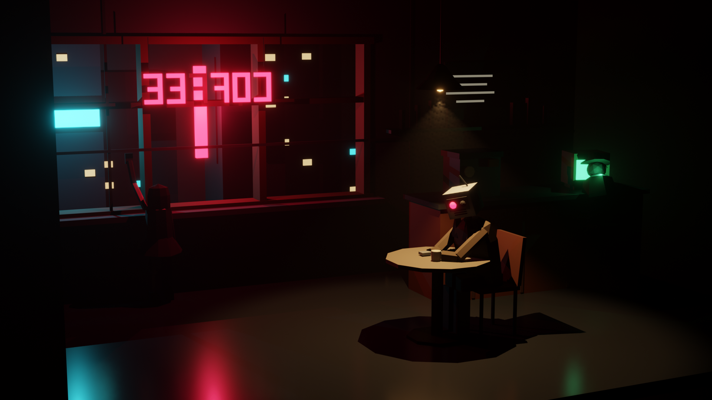
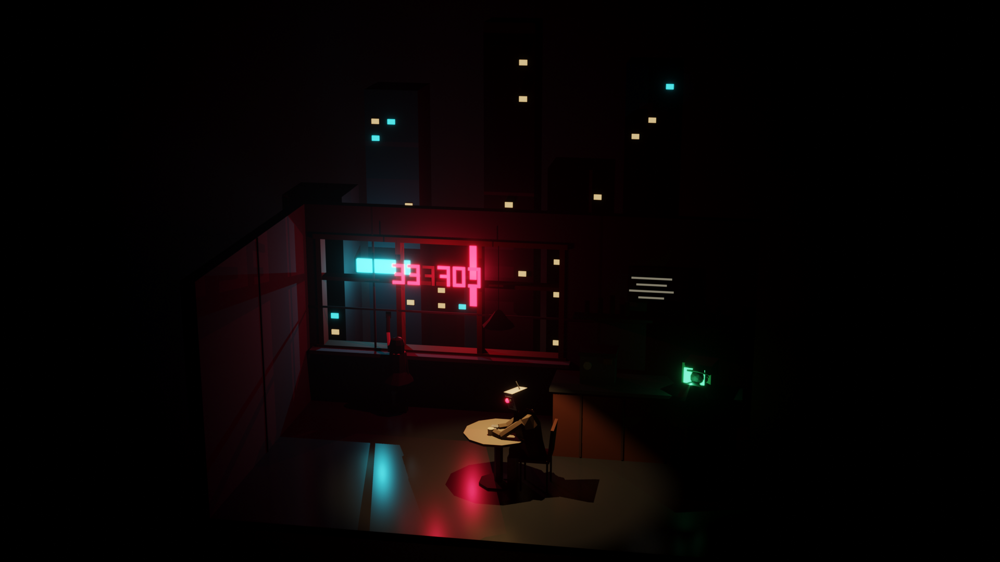
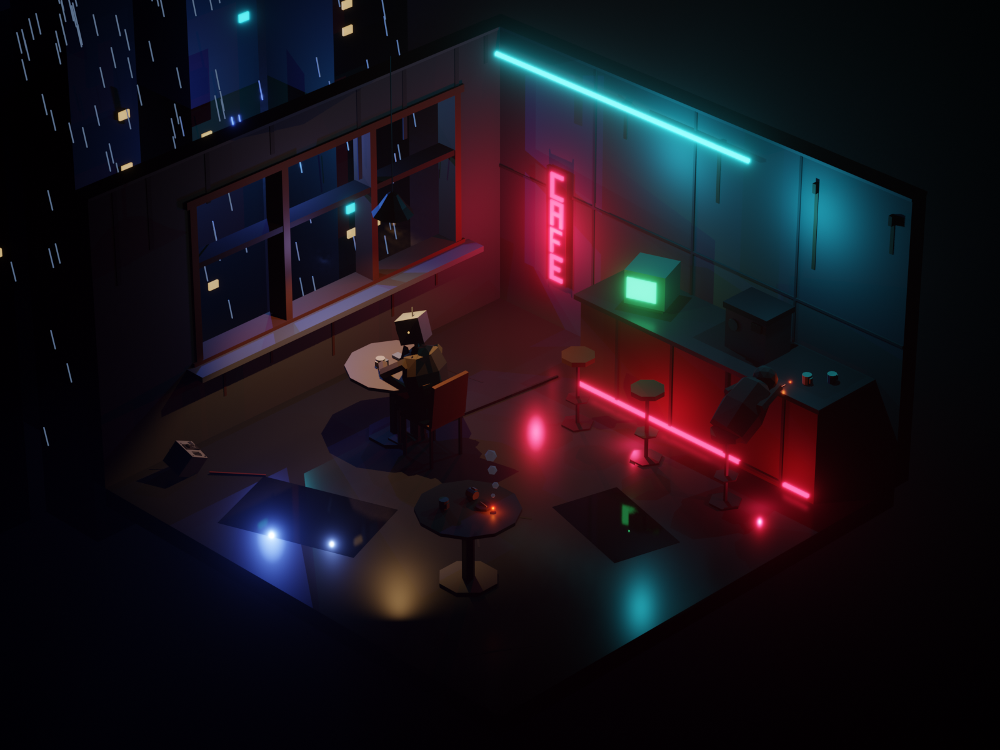
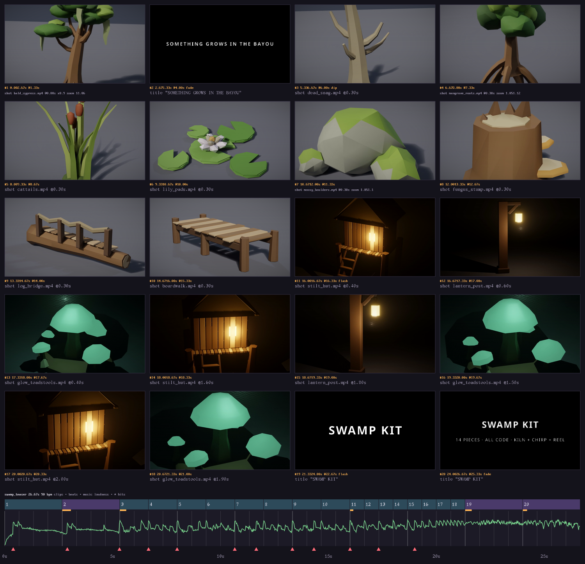
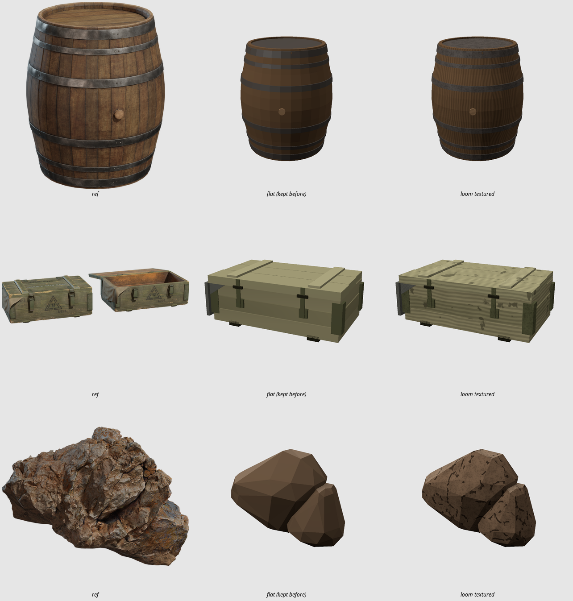
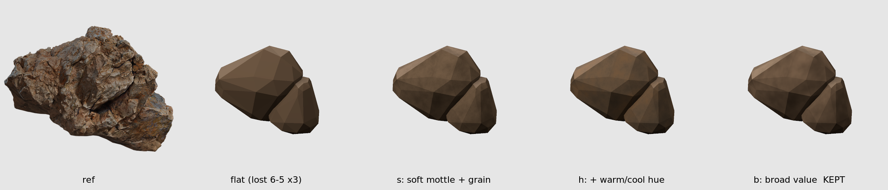

# kiln

**Low-poly and voxel 3D game assets as code.** Write a small `.kx.js` file of primitives, voxel
layers, lights, mirrors and scatters. kiln builds flat-shaded meshes, exports **GLB** for Godot,
Unity, Unreal and Three.js, renders previews an AI agent can read, and hands off to **Blender**
for beauty renders, turntables and camera-move videos.

Part of a family with [**vex**](https://github.com/uilianks/vex) (vector art, skeletal animation), [**pxl**](https://github.com/uilianks/pxl) (pixel art), [**chirp**](https://github.com/uilianks/chirp) (game audio) and [**loom**](https://github.com/uilianks/loom) (seamless textures and PBR materials), inspired by
[**claude-pxl**](https://github.com/crsolver/claude-pxl): sandboxed source files, lazy cached
builds, errors with exact locations, and a live viewer.

## Showcase

Everything below is code in [`showcase/`](showcase/), rendered by kiln and Blender. No modeling
by hand, no image models.

### THE DRAGON'S HOARD: textured with loom

[](docs/media/dragon_hoard.mp4)

▶ **[Watch the camera push-in](docs/media/dragon_hoard.mp4)** · source: [`dragon_hoard.kx.js`](showcase/dragon_hoard.kx.js)

Every surface is a seamless PBR material from [**loom**](https://github.com/uilianks/loom): mossy brick,
wet cobblestone, stained concrete, worn wood, rusted iron, lava rock (emissive), dragon scales and
hammered gold. A palette entry points at the loom output (`{ tex: T + "brick_wall", uv: 1.5 }`); kiln
box-projects UVs onto every face and embeds albedo, normal, ORM and emissive in the GLB, so Blender
(and any engine) renders real relief, roughness and glow. Lit only by the scene: a lava pit, two torches,
the egg's glow and a spot on the niche.

### LAST CUP: a cyberpunk noir diorama



▶ **[Watch in 1080p with sound](docs/media/last_cup_3d.mp4)**: a 10 s camera move, with the soundtrack synthesized
by chirp · source: [`last_cup.kx.js`](showcase/last_cup.kx.js)

A broken robot alone at a table under the only warm lamp, one red eye still glowing. A woman with
a steel leg presses her hand to the window. COFFEE hangs backwards in the glass with a dead F, a
green CRT hums at the bar, brutalist towers stand outside, and neon bleeds across the wet floor.
It's lit only by the scene's own `light()` items: one spot, seven points, and emissive neon.

| close | wide |
|---|---|
|  |  |

The same scene exists as a 2D illustration in [vex](https://github.com/uilianks/vex) and as a
soundscape in [chirp](https://github.com/uilianks/chirp): one world across three tools.

### It moves

▶ **[LAST CUP, animated: 10 s with sound](docs/media/last_cup_3d_sip.mp4)**. The robot lifts the mug to his face and
drinks, the dying F on the sign blinks, and the pendant lamp sways so its light pool drifts across the table,
all while the camera pushes in. Parts are named nodes with pivots; clips export as glTF animations that
Blender (and any engine) plays.

```js
part("upper", { pivot: [0.2, 1.0, 0.14] }, limb(...),
  part("fore", { pivot: [0.22, 0.79, 0.42] }, limb(...),
    part("cup", { pivot: [0.12, 0.78, 0.55] }, stamp("_mug", { pos: [0.12, 0.755, 0.58] }))))
animate("last_cup", "sip", { frames: 240, fps: 24 }, {
  upper: { rot: [[48, [0, 0, 0]], [110, [0, 0, -60]], [160, [0, 0, -60]], [214, [0, 0, 0]]] },
  flicker: { scale: [[0, 1, "step"], [31, 0.001, "step"], [34, 1]] },
})
```

### LAST CUP, isometric

[](docs/media/last_cup_iso.mp4)

▶ **[10 s with sound](docs/media/last_cup_iso.mp4)** · source: [`last_cup_iso.kx.js`](showcase/last_cup_iso.kx.js)

The [pxl](https://github.com/uilianks/pxl/tree/main/showcase) isometric pixel-art room rebuilt in 3D: a
cutaway cube seen from the front-right corner with a long lens (45° yaw, 30° pitch, true isometric).
The window is in the left wall with rain falling past it, and the counter, CRT and a vertical CAFE
sign are on the back wall. A hooded sleeper is slumped on the bar, another robot's dead head lies on the
floor, and the puddles hold the neon. The `night` clip plays rain, the dying F, smoke, the swaying bulb
and one slow sip; the soundtrack is chirp's `last_cup_iso_3d` mix, timed to the same frames.

```sh
kiln render showcase/last_cup_iso.kx.js last_cup_iso --mood night --fog 0.02 --yaw 45 --pitch 30 \
  --lens 135 --focus 0.1,1.3,0.1 --zoom 1.5 --no-ground --frames 240 --clip night --still-camera \
  --audio ../chirp/showcase/out/sfx/last_cup_iso_3d.wav
```

### Forest Kit 3D: a game-ready asset pack


▶ [1080p turntable (MP4)](docs/media/island_turntable.mp4) · source: [`forest_kit.kx.js`](showcase/forest_kit.kx.js)


A voxel hero, slime and chest beside low-poly trees, pines, rocks, crystals, a campfire, a torch,
a coin, a crate, a fence and a log cabin. It's one GLB with 17 named meshes and 3,858 triangles;
the floating-island diorama is 5,514.

### Swamp kit teaser (Grayson fork)



▶ **[26.7 s teaser with sound](docs/media/swamp_teaser.mp4)**: the swamp kit (`smoke/swamp.kx.js`) as kiln turntables,
cut by [reel](https://github.com/graysonchalmers/reel/tree/grayson/showcase/swamp) to a chirp score.

### loom textures on image-to-blockout (Grayson fork)



Reference, flat build, loom PBR build. Barrel and crate won the blind A/B and are kept textured.
The boulder's crack-decal stone lost; a softer stone (broad low-contrast value, no hard shapes) won the retry 6-5:



### What the agent sees

Every build writes a 4-view preview with dimensions, triangle count, grid scale and materials,
drawn by kiln's own rasterizer (scenes with lights render at night). That's how the agent checks
proportions and catches a roof rotated about the wrong axis, or a robot with no arms, before
anyone looks.

| voxel hero | log cabin |
|---|---|
|  |  |

## Quick start

```bash
git clone https://github.com/uilianks/kiln && cd kiln
npm install
node bin/kiln.js build examples/basics.kx.js          # -> examples/out/models/*.glb + previews
node bin/kiln.js serve showcase/last_cup.kx.js        # live viewer on http://127.0.0.1:4340
```

In the viewer, **✎ annotate** (or `a`) freezes the camera so you can pin notes on the model and draw on
it, then *send to Claude*. Each pin is mapped onto the model's surface: the feedback says which material,
part and build step (with its source line) you pointed at, so "check the feedback" is enough.

```js
pal({ bark: "#6e4535", leaf: "#3d8c48", leafL: "#74c45a", wood: "#9c6a4d", woodD: "#6e4535",
  bulb: { color: "#ffd28c", emit: "#ffc070", glow: 10 }, t: "#3b67c0" })

model("pine",
  cyl(0.12, 0.7, { mat: "bark", sides: 5 }),
  [[0.8, 0.5, 1.1], [0.6, 1.05, 0.95], [0.4, 1.55, 0.8]].map(([r, y, h], i) =>
    cone(r, h, { mat: i % 2 ? "leaf" : "leafL", sides: 7, pos: [0, y, 0], jitter: 0.035 })))

model("crate", box(0.6, 0.6, 0.6, "wood"),
  sym("x", sym("z", box(0.08, 0.62, 0.08, { mat: "woodD", pos: [0.28, -0.01, 0.28] }))))

model("lamp", sphere(0.05, { mat: "bulb" }),
  light({ type: "spot", color: "#ffbe78", power: 200, pos: [0, -0.1, 0], dir: [0, -1, 0], angle: 50 }))

model("gem", voxels([`.t.\nttt\n.t.`, `.t.`], { size: 0.1 }))

model("grove", scatter("pine", { area: [-3, -3, 3, 3], count: 6, scale: [0.7, 1.1] }), stamp("crate"))
pack("kit", ["pine", "crate", "gem"])
```

### Renders and videos (Blender)

```bash
kiln render scene.kx.js island --size 1920x1080 --no-ground                     # beauty still
kiln render scene.kx.js island --frames 180                                     # turntable MP4
kiln render scene.kx.js last_cup --mood night --focus 0.1,2.65,2.1 --zoom 1.3 \
  --frames 300 --yaw 18 --yaw-to -28 --zoom-to 3 --audio soundtrack.wav         # camera move + sound
```

## Features

- **Low-poly primitives:** box, cylinder (tapering), cone, icosphere, rock, lathe, extrude (any
  outline, concave ok), gable prism, wedge, plus vertex jitter for a hand-made look.
- **Voxels:** text layers like pixel art, a function of (x, y, z), or `voximg()`: a pixel-art PNG
  extruded into voxels with one material per color; greedy-meshed.
- **Tubes and terrain:** `torus`, `tube` along a path (pipes, cables, branches; mitered, twist-free)
  and `terrain` heightfields from a function or a loom height map, with materials picked per triangle
  by height and slope. `--stl` exports for 3D printing.
- **Structure:** transforms, mirror symmetry, stamps, scatter, random groups, material-swap variants.
- **Animation:** named `part()`s with pivots and keyframed `animate()` clips (rotation, offset, scale, five
  easings), exported as glTF animations, previewed as frame strips, played in Blender renders.
- **Lights:** point and spot `light()` items that move with the model through stamps, mirrors and
  scatter. They export as `KHR_lights_punctual`.
- **Game-ready GLB:** flat normals, PBR materials, emissive strength, one primitive per material,
  named nodes, lights; packs for asset libraries. Models are re-centered with their base on y = 0.
- **Agent eyes:** a built-in rasterizer with shadows, a ground grid and night lighting: 4-view
  previews, `kiln info`, turntable GIFs.
- **Live viewer:** drag to orbit, replay the build step by step, download the GLB, rebuild on save.
- **Blender renders:** headless EEVEE with AgX and bloom. Day or night mood (moonlight, volumetric
  haze), focus, zoom and lens; turntables and eased camera moves to MP4 with an optional soundtrack.

### Tested

Every primitive's signed volume equals the exact solid, so all faces point outward. Mirrors,
jitter and voxels stay closed. The GLB structure, materials and lights are checked byte by byte.
Every showcase GLB imports and renders in Blender 5.2, and renders fail loudly if the output file
never appears (for example, a sandboxed Blender writing outside your home directory).

Agent workflow: [SKILL.md](SKILL.md) · Full API: [reference.md](reference.md)

## Use as a Claude Code skill

```bash
git clone https://github.com/uilianks/kiln ~/.claude/skills/kiln-3d-assets
cd ~/.claude/skills/kiln-3d-assets && npm install
```

Requires Node ≥ 22.18. Blender (optional, for `render`, found via `$KILN_BLENDER`, `blender` on
PATH, or the `org.blender.Blender` flatpak) and ffmpeg (optional, for GIF/MP4).
`npm run check` typechecks and runs the tests.

## License

[MIT](LICENSE). Portions adapted from [claude-pxl](https://github.com/crsolver/claude-pxl)
(MIT, © crsolver), via vex.
