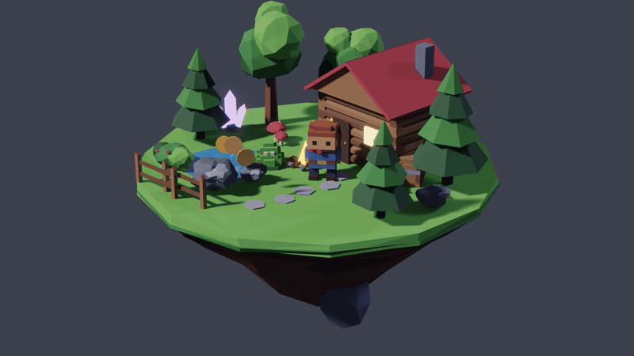
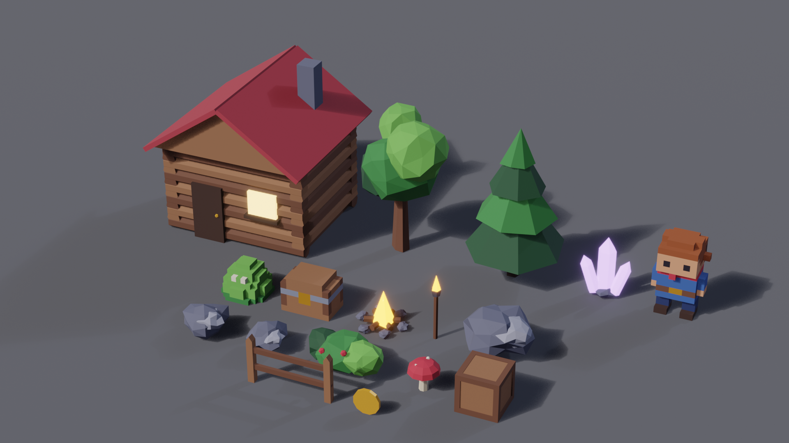
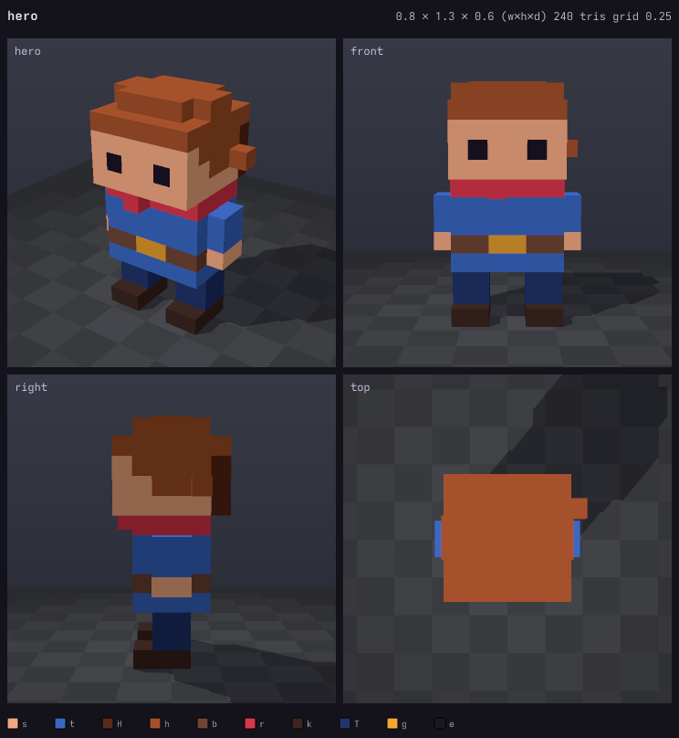
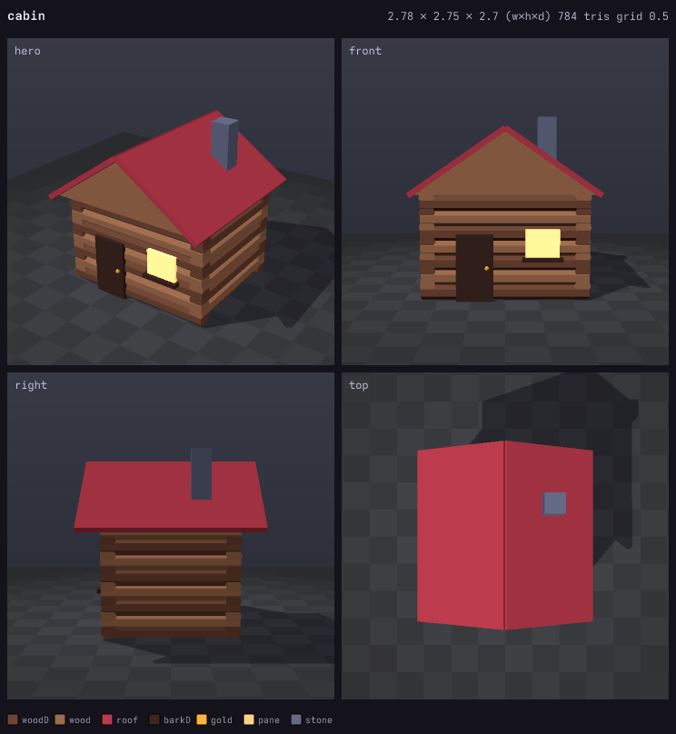

# kiln

**Low-poly and voxel 3D game assets as code.** Write a small `.kx.js` file of primitives, voxel
layers, mirrors and scatters; kiln builds flat-shaded meshes and exports **GLB** for Godot, Unity,
Unreal and Three.js, renders previews an AI agent can read, and hands off to **Blender** for beauty
renders and turntable videos.

Third sibling of [**vex**](https://github.com/uilianks/vex) (vector art) and
[**chirp**](https://github.com/uilianks/chirp) (game audio), inspired by
[**claude-pxl**](https://github.com/crsolver/claude-pxl): sandboxed source files, lazy cached
builds, errors with exact locations, and a live viewer.

## Showcase: Forest Kit 3D

The Forest Kit platformer world, now in 3D: a voxel hero, slime and chest beside low-poly trees,
rocks, crystals, a campfire and a log cabin, composed into a floating island.
Source: [`showcase/forest_kit.kx.js`](showcase/forest_kit.kx.js).



▶ [1080p turntable (MP4)](docs/media/island_turntable.mp4) · [still](docs/media/island.png)



The whole pack is one GLB with 17 named meshes and 3,858 triangles (the island diorama is 5,514).

### What the agent sees

Every build writes a 4-view preview with dimensions, triangle count, grid scale and materials,
rendered by kiln's own rasterizer. That's how the agent checks proportions and catches a roof
rotated about the wrong axis before you ever look.

| voxel hero | log cabin |
|---|---|
|  |  |

## Quick start

```bash
git clone https://github.com/uilianks/kiln && cd kiln
npm install
node bin/kiln.js build examples/basics.kx.js         # -> examples/out/models/*.glb
node bin/kiln.js serve showcase/forest_kit.kx.js     # live viewer on http://127.0.0.1:4340
node bin/kiln.js render showcase/forest_kit.kx.js island --size 1920x1080 --no-ground   # needs Blender
```

```js
pal({ bark: "#6e4535", leaf: "#3d8c48", leafL: "#74c45a", wood: "#9c6a4d", woodD: "#6e4535",
  s: "#f0a882", t: "#3b67c0" })

model("pine",
  cyl(0.12, 0.7, { mat: "bark", sides: 5 }),
  [[0.8, 0.5, 1.1], [0.6, 1.05, 0.95], [0.4, 1.55, 0.8]].map(([r, y, h], i) =>
    cone(r, h, { mat: i % 2 ? "leaf" : "leafL", sides: 7, pos: [0, y, 0], jitter: 0.035 })))

model("crate", box(0.6, 0.6, 0.6, "wood"),
  sym("x", sym("z", box(0.08, 0.62, 0.08, { mat: "woodD", pos: [0.28, -0.01, 0.28] }))))

model("gem", voxels([`.t.\nttt\n.t.`, `.t.`], { size: 0.1 }))

model("grove", scatter("pine", { area: [-3, -3, 3, 3], count: 6, scale: [0.7, 1.1] }), stamp("crate"))
pack("kit", ["pine", "crate", "gem"])
```

## Features

- **Low-poly primitives:** box, cylinder (tapering), cone, icosphere, rock, lathe, extrude (any
  outline, concave ok), gable prism, wedge, plus vertex jitter for a hand-made look.
- **Voxels:** text layers like pixel art, or a function of (x, y, z); greedy-meshed.
- **Structure:** transforms, mirror symmetry, stamps, scatter, random groups, material-swap variants.
- **Game-ready GLB:** flat normals, PBR materials, emissive strength, one primitive per material,
  named nodes; packs for asset libraries. Models are re-centered with their base on y = 0.
- **Agent eyes:** a built-in flat-shading rasterizer with shadows and a ground grid: 4-view previews,
  `kiln info`, and turntable GIFs.
- **Live viewer:** drag to orbit, replay the build step by step, download the GLB, rebuild on save.
- **Blender beauty renders:** headless EEVEE with AgX, sun and sky lights, bloom, and turntable MP4s.

Correctness is tested: every primitive's signed volume equals the analytic solid (so all faces
point outward), mirrors and voxels stay closed, and GLB structure is checked byte by byte.
Real-tool check: the showcase GLBs import and render in Blender 5.2.

Agent workflow: [SKILL.md](SKILL.md) · Full API: [reference.md](reference.md)

## Use as a Claude Code skill

```bash
git clone https://github.com/uilianks/kiln ~/.claude/skills/kiln-3d-assets
cd ~/.claude/skills/kiln-3d-assets && npm install
```

Requires Node ≥ 22.18. Blender (optional, for `render`) and ffmpeg (optional, for GIF/MP4 turntables).
`npm run check` typechecks and runs the tests.

## License

[MIT](LICENSE). Portions adapted from [claude-pxl](https://github.com/crsolver/claude-pxl)
(MIT, © crsolver), via vex.
